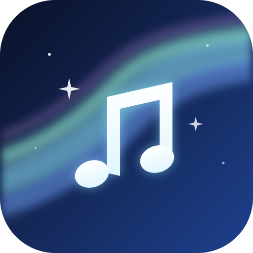
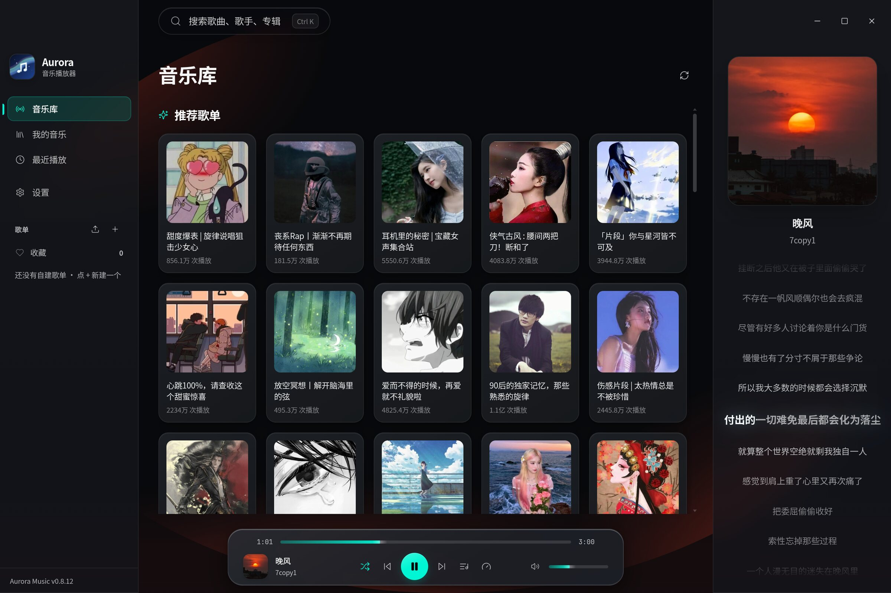
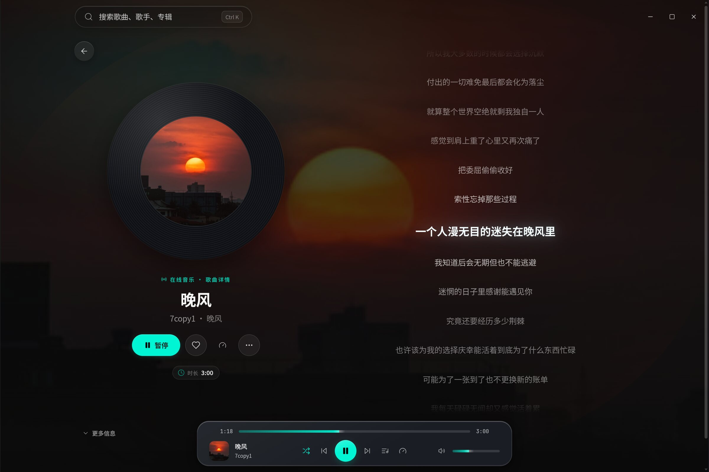
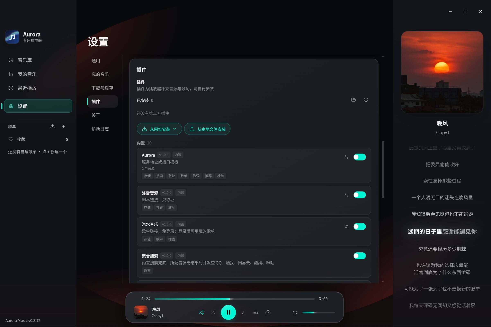
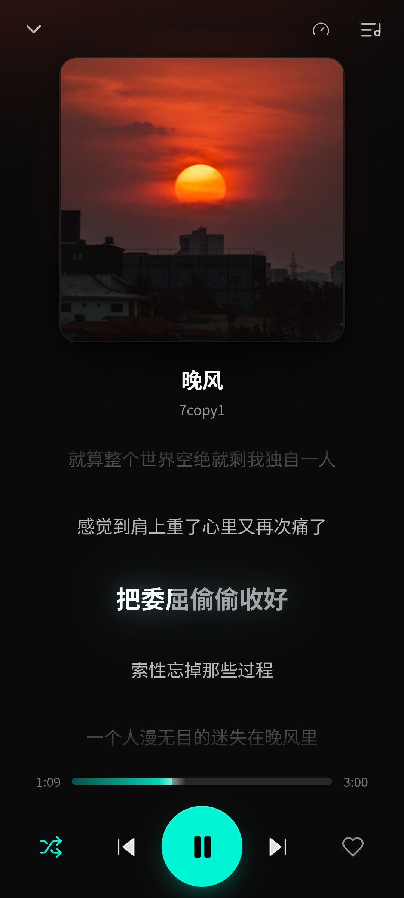

# Aurora Music

<p align="center"></p>

<p align="center">
  <strong>Aurora Music</strong> — a cross-platform music player for desktop (Linux / Windows / macOS) and Android, with one shared UI.<br/>
  The desktop app is Electron + React; the mobile app is packaged with Capacitor and hands playback to a native engine.<br/>
  
  
  &nbsp;·&nbsp; <a href="./README.md">中文说明</a>
</p>

---

## Screenshots

<p align="center"></p>

<table align="center"><tr>
  <td></td>
  <td></td>
</tr></table>

<p align="center"></p>

---

## Overview

A player that brings its own library management, online search and multi-device sync: local folders, WebDAV and network storage all go into your collection, online playback uses the music source you configure, and playlists and favorites sync across devices.

- **Library** — scan local folders, WebDAV or SMB / SFTP network storage; indexed progressively and playable offline, with a prompt (and a fresh copy) when an encrypted track turns up
- **Online** — search / preview / download / cache; bring your own source, either an HTTP protocol source or an LX Music script, and a script-only setup can still search (built-in aggregate-search fallback), with cross-source address resolution and platform detection from the track URL
- **Playlists & favorites** — manage playlists, import and export M3U; sync across devices over WebDAV or direct LAN, including one-tap pairing (the code never lands in your hands or on the wire), with per-track conflict handling for favorites
- **Playback** — word-by-word LRC lyrics, spectrum visualizer, queue with repeat / shuffle, speed control, sleep timer; MPRIS and tray on desktop, foreground-service playback on Android, configurable audio-focus behavior on both
- **Plugin system** — sources, storage and sync are all plugins; a missing capability is "method absent", never a shape check on the caller side
- **Consistent everywhere** — one UI for desktop, phones and older in-car WebViews; Simplified Chinese and English, following the system locale
- **Self-updating** — checks the latest GitHub release, matches the asset for your platform and verifies its sha256 before downloading

---

## Download

Released builds live in [Releases](https://github.com/yib0601/aurora-music/releases):

| Platform | Assets | Notes |
| --- | --- | --- |
| Linux x64 | `Aurora-Music-<version>-x64.AppImage` / `.deb` / `.rpm` | AppImage is portable; the baseline is glibc 2.35 (Ubuntu 22.04) |
| Linux ARM64 | `Aurora-Music-<version>-arm64.AppImage` / `.deb` / `.rpm` | Raspberry Pi 4/5, ARM laptops and servers; same glibc 2.35 baseline |
| Windows x64 | `Aurora-Music-<version>-x64.exe` | NSIS installer, install directory selectable |
| Windows ARM64 | `Aurora-Music-<version>-arm64.exe` | Snapdragon X and other ARM devices; use the x64 build on x64 machines |
| macOS | `Aurora-Music-<version>-arm64.dmg` / `-x64.dmg` | Apple Silicon / Intel, ad-hoc signed — allow it once under Privacy & Security |
| Android | `app-debug.apk` | Debug-signed; versionCode increases monotonically so it upgrades in place |

Every desktop platform ships both arm64 and x64 builds, with the architecture in the filename; the in-app updater picks the right one from `process.arch`.

"Settings → About" inside the app also checks for updates and fetches the matching asset.

---

## Getting started

```bash
git clone https://github.com/yib0601/aurora-music.git && cd aurora-music
pnpm install
pnpm rebuild          # rebuild the better-sqlite3 native module
pnpm dev              # desktop app (Electron + Vite HMR)
pnpm dev:app          # web UI only
```

Requirements: Node.js ≥ 20, pnpm 9.15 (pinned via `packageManager`); Android builds additionally need JDK 17+ and the Android SDK.

Other entry points:

```bash
pnpm --filter @aurora/shared test    # source protocol, LX host and other pure logic
pnpm --filter @aurora/app test       # renderer and mobile cache persistence
pnpm --filter @aurora/app lint       # renderer eslint
pnpm build:deb                       # build a deb (via build-deb.sh)
pnpm build:android                   # build the release APK
pnpm verify:webview                  # in-car WebView compatibility lock (build first)
```

See [docs/development.md](./docs/development.md) and [docs/desktop-packaging.md](./docs/desktop-packaging.md) for details (Chinese).

---

## Layout

```
packages/
  app/       React renderer: pages, components, state, i18n bindings (desktop and mobile)
  shared/    Cross-platform logic: source protocol, LX host, cover matching, encrypted audio, lyrics, i18n core
  desktop/   Electron main: windows, tray, MPRIS, IPC, SQLite library
  mobile/    Capacitor project plus the Android native playback service (Kotlin)
docs/        Protocol and architecture documents (Chinese)
```

---

## Docs

| Document | What it covers |
| --- | --- |
| [music-sources.md](./docs/music-sources.md) | Source protocol: HTTP sources and LX scripts side by side |
| [plugins.md](./docs/plugins.md) | Plugin contract: capability declaration and what a missing method means |
| [plugin-system.md](./docs/plugin-system.md) | Plugin layering, origins and the install path |
| [plugin-capabilities.md](./docs/plugin-capabilities.md) | What the host injects, and how the built-in source became a plugin |
| [storage-protocols.md](./docs/storage-protocols.md) | Why SMB / SFTP are plugins rather than built-ins |
| [playlist-sync.md](./docs/playlist-sync.md) | Playlist and favorite sync: WebDAV and direct LAN |
| [i18n.md](./docs/i18n.md) | How copy is produced, passed and rendered |
| [development.md](./docs/development.md) | Tests, lint, in-car WebView lock, packaging and release |
| [design-system.md](./docs/design-system.md) / [style-sheet.md](./docs/style-sheet.md) | Design language and implementation-level style spec |

---

## Feedback

Bugs and suggestions go to [Issues](https://github.com/yib0601/aurora-music/issues). For playback problems, include the track origin (local / WebDAV / which source) and the platform version — it saves a round trip.

---

## License

[PolyForm Noncommercial License 1.0.0](./LICENSE) — commercial use is not permitted. Personal use, study, modification and non-commercial distribution are unrestricted; commercial use requires permission from the author. Versions up to v0.4.2 remain MIT licensed.
