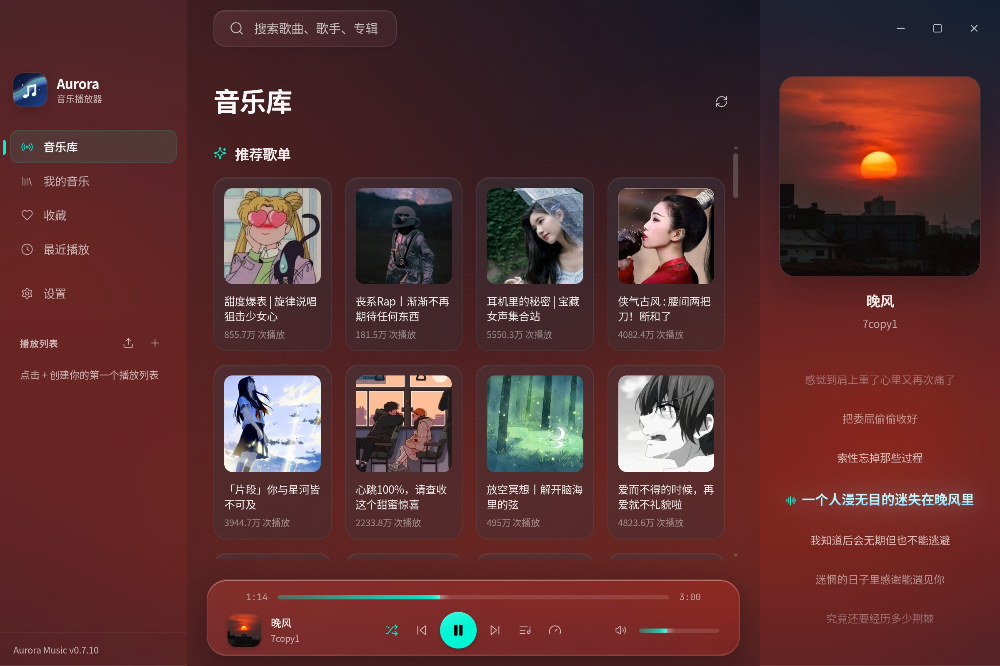
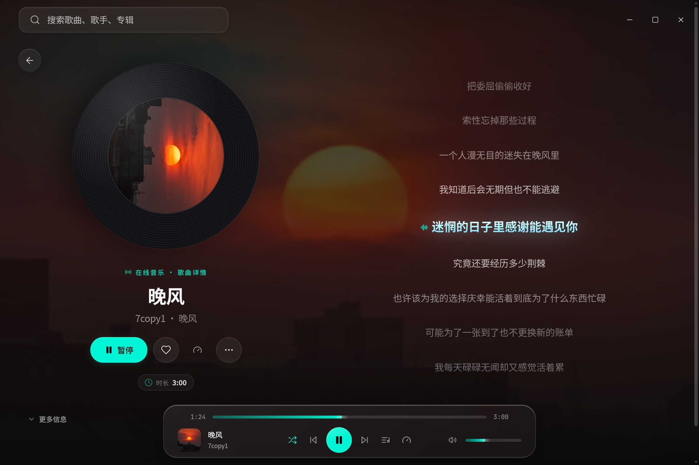
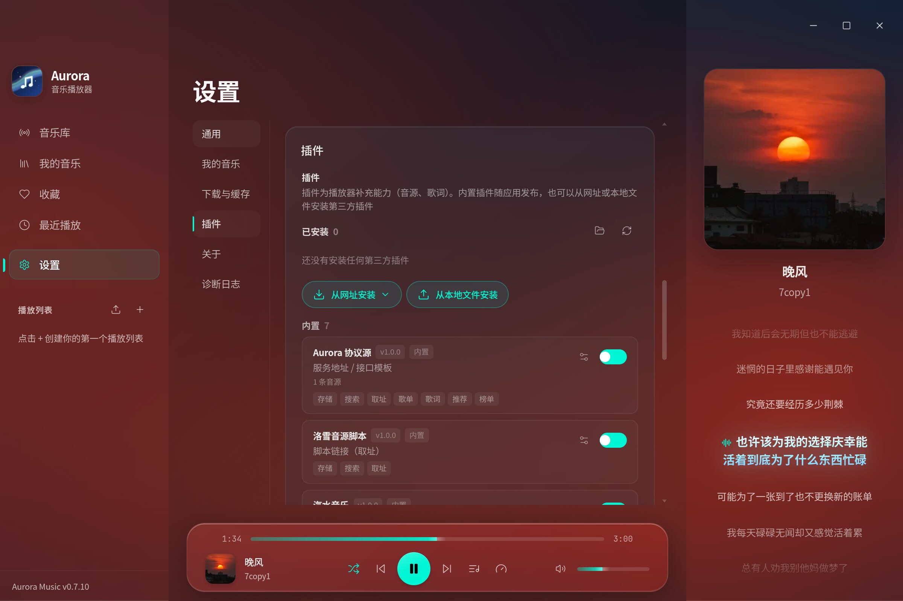

# Aurora Music

<p align="center"></p>

<p align="center">
  <strong>Aurora Music</strong> — a cross-platform music player for desktop (Linux / Windows / macOS) and Android, with one shared UI.<br/>
  The desktop app is Electron + React; the mobile app is packaged with Capacitor and hands playback to a native engine.<br/>
  
  &nbsp;·&nbsp; <a href="./README.md">中文说明</a>
</p>

---

## Screenshots

<p align="center"></p>

<table align="center"><tr>
  <td></td>
  <td></td>
</tr></table>

<p align="center"></p>

---

## Overview

A player that brings its own library management, online search and multi-device sync: local folders and WebDAV both go into your collection, online playback uses the music source you configure, and playlists and favorites sync across devices.

- **Library** — scan local folders or WebDAV media libraries, indexed progressively and playable offline
- **Online** — search / preview / download / cache; bring your own source, either the HTTP protocol or an LX Music script, and a script-only setup can still search (built-in aggregate-search fallback)
- **Playlists & favorites** — manage playlists, import and export M3U; sync across devices over WebDAV or direct LAN with one-tap pairing
- **Playback** — LRC lyrics, queue with repeat / shuffle, speed control, sleep timer; configurable audio-focus behavior on both desktop and Android
- **Consistent everywhere** — tray playback on desktop, foreground-service playback on Android; Simplified Chinese and English

---

## Getting started

```bash
git clone https://github.com/yib0601/aurora-music.git && cd aurora-music
pnpm install
pnpm rebuild          # rebuild the better-sqlite3 native module
pnpm dev              # desktop app (Electron + Vite HMR)
pnpm dev:app          # web UI only
```

Requirements: Node.js ≥ 20, pnpm ≥ 9.15; Android builds additionally need JDK 17+ and the Android SDK.

The music-source protocol, playlist sync, plugin system, development and packaging are documented in [docs/](./docs/) (Chinese).

---

## License

[PolyForm Noncommercial License 1.0.0](./LICENSE) — commercial use is not permitted. Personal use, study, modification and non-commercial distribution are unrestricted; commercial use requires permission from the author. Versions up to v0.4.2 remain MIT licensed.
