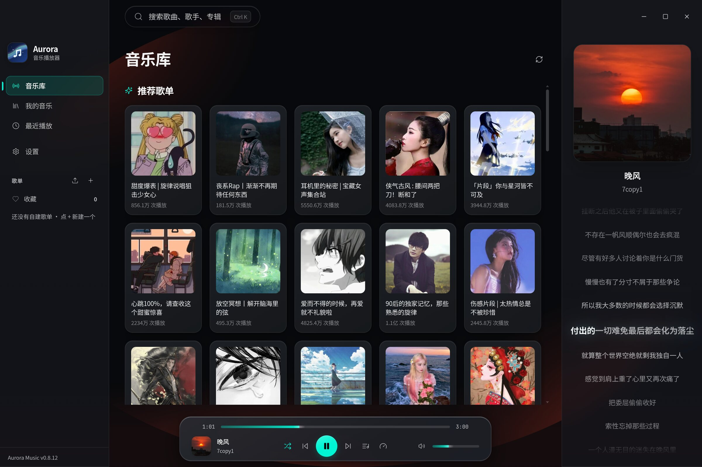
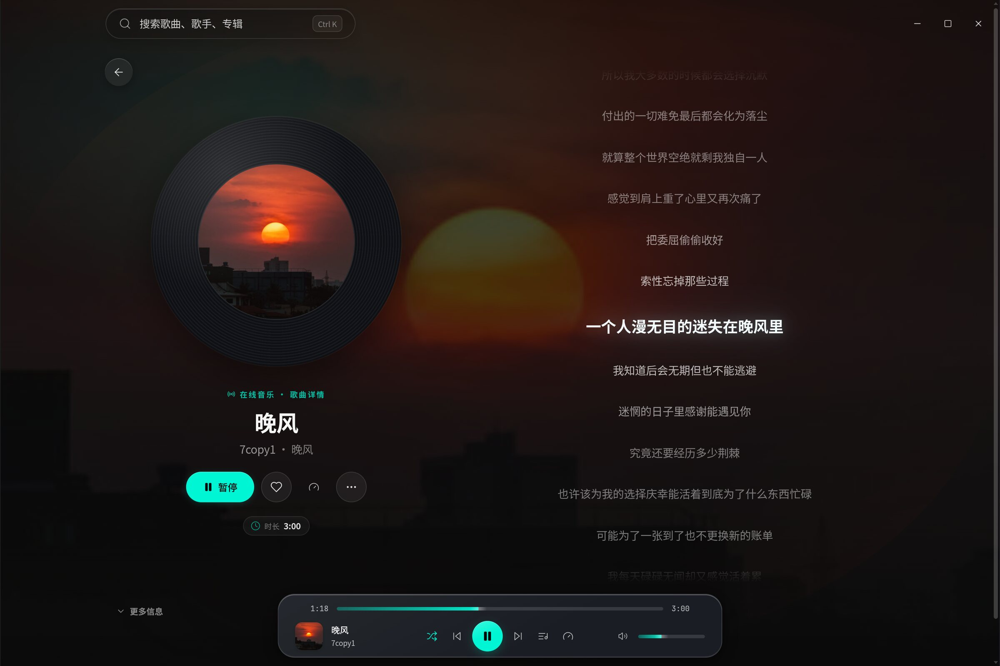
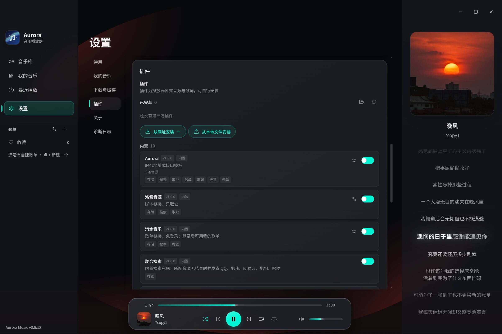

# Aurora Music

<p align="center"></p>

<p align="center">
  <strong>Aurora Music</strong> — 跨平台音乐播放器，桌面（Linux / Windows / macOS）与 Android 同一套界面。<br/>
  桌面端 Electron + React，移动端 Capacitor 打包、原生播放引擎接管播放。<br/>
  
  
  &nbsp;·&nbsp; <a href="./README.en.md">English</a>
</p>

---

## 截图

<p align="center"></p>

<table align="center"><tr>
  <td></td>
  <td></td>
</tr></table>

<p align="center"></p>

---

## 简介

一个自带曲库管理、在线搜索与多端同步的播放器：本地文件夹、WebDAV 与网络存储都能入库，
在线听歌靠你配置的音源，歌单与收藏可以在多台设备间同步。

- **曲库** — 扫描本地文件夹、WebDAV 或 SMB / SFTP 网络存储入库；渐进式扫描、离线可播，
  遇到加密音频会提示并按名重下一份明文副本
- **在线** — 搜索 / 试听 / 下载 / 缓存；音源自配，支持 HTTP 协议源与洛雪脚本，
  只配脚本也能搜（内置「聚合搜索」兜底），取址跨源、平台按曲目地址自动识别
- **歌单与收藏** — 歌单管理、M3U 导入导出；经 WebDAV 或局域网直连在多设备间同步，
  局域网支持一键配对（配对码不落手、不进明文网络），收藏按每首歌逐条比对冲突
- **播放** — LRC 逐字歌词、频谱可视化、队列与循环 / 随机、变速、睡眠定时；
  桌面走 MPRIS 与托盘，Android 走前台服务续播，两端都能配音频焦点行为
- **插件体系** — 音源、存储、同步都是插件；缺哪个能力就报「方法不存在」，调用方不做形态判断
- **多端一致** — 同一套界面适配桌面、手机与车机老 WebView；简体中文 / English 跟随系统
- **自带更新** — 应用内检查 GitHub Releases 最新版，按当前系统匹配安装包并校验 sha256 后下载

---

## 下载与安装

已发布版本见 [Releases](https://github.com/yib0601/aurora-music/releases)：

| 平台 | 产物 | 说明 |
| --- | --- | --- |
| Linux x64 | `Aurora-Music-<版本>-x64.AppImage` / `.deb` / `.rpm` | AppImage 免安装；包基线固定 glibc 2.35（Ubuntu 22.04） |
| Linux ARM64 | `Aurora-Music-<版本>-arm64.AppImage` / `.deb` / `.rpm` | 树莓派 4/5、ARM 笔记本与服务器；同一 glibc 2.35 基线 |
| Windows x64 | `Aurora-Music-<版本>-x64.exe` | NSIS 安装器，可选安装目录 |
| Windows ARM64 | `Aurora-Music-<版本>-arm64.exe` | 骁龙 X 等 ARM 设备；x64 机器请用上面那个 |
| macOS | `Aurora-Music-<版本>-arm64.dmg` / `-x64.dmg` | Apple Silicon / Intel，ad-hoc 签名，首次启动需在「隐私与安全性」放行 |
| Android | `app-debug.apk` | debug 签名；versionCode 单调递增，可直接覆盖升级 |

桌面端每个平台都出 arm64 与 x64 两份，**文件名后缀已标明架构**；应用内更新会按 `process.arch` 自动挑本机那份。

应用内「设置 → 关于」也能检查更新并下载对应安装包。

---

## 快速开始

```bash
git clone https://github.com/yib0601/aurora-music.git && cd aurora-music
pnpm install
pnpm rebuild          # 重建 better-sqlite3 原生模块
pnpm dev              # 桌面端（Electron + Vite 热重载）
pnpm dev:app          # 仅 Web UI
```

需 Node.js ≥ 20、pnpm 9.15（`packageManager` 已锁定）；Android 构建另需 JDK 17+ 与 Android SDK。

常用的其余入口：

```bash
pnpm --filter @aurora/shared test    # 音源协议、洛雪宿主等纯逻辑
pnpm --filter @aurora/app test       # 渲染层与移动端缓存落盘
pnpm --filter @aurora/app lint       # 渲染层 eslint
pnpm build:deb                       # 打 deb 包（走 build-deb.sh）
pnpm build:android                   # 打 release APK
pnpm verify:webview                  # 车机老 WebView 兼容锁（需先 build）
```

细节见 [docs/development.md](./docs/development.md) 与 [docs/desktop-packaging.md](./docs/desktop-packaging.md)。

---

## 目录结构

```
packages/
  app/       React 渲染层：页面、组件、状态、i18n 绑定（桌面与移动共用）
  shared/    跨端纯逻辑：音源协议、洛雪宿主、封面匹配、加密音频、歌词、i18n 内核
  desktop/   Electron 主进程：窗口、托盘、MPRIS、IPC、SQLite 曲库
  mobile/    Capacitor 工程与 Android 原生播放服务（Kotlin）
docs/        协议与体系文档（中文）
```

---

## 文档

| 文档 | 内容 |
| --- | --- |
| [music-sources.md](./docs/music-sources.md) | 音源协议：HTTP 协议源与洛雪脚本如何共存 |
| [plugins.md](./docs/plugins.md) | 插件契约：能力声明、方法缺失的含义 |
| [plugin-system.md](./docs/plugin-system.md) | 插件体系分层、来源与安装链路 |
| [plugin-capabilities.md](./docs/plugin-capabilities.md) | 宿主向插件注入了什么，乐源如何插件化 |
| [storage-protocols.md](./docs/storage-protocols.md) | 为什么 SMB / SFTP 走插件而不进本体 |
| [playlist-sync.md](./docs/playlist-sync.md) | 歌单与收藏同步：WebDAV 与局域网直连 |
| [i18n.md](./docs/i18n.md) | 文案从产生到渲染的三段式约束 |
| [development.md](./docs/development.md) | 测试、lint、车机 WebView 兼容锁、打包发布 |
| [design-system.md](./docs/design-system.md) / [style-sheet.md](./docs/style-sheet.md) | 设计语言与实现层样式规格 |

---

## 反馈

问题与建议走 [Issues](https://github.com/yib0601/aurora-music/issues)；提播放相关问题时，
附上曲目来源（本地 / WebDAV / 哪个音源）与平台版本，能省一轮来回。

---

## 许可

[PolyForm Noncommercial License 1.0.0](./LICENSE)：禁止商业用途。个人使用、学习、二次修改与非商业分发不受限制，商业目的的使用需联系作者授权。v0.4.2 及更早的已发布版本仍按 MIT 授权。
