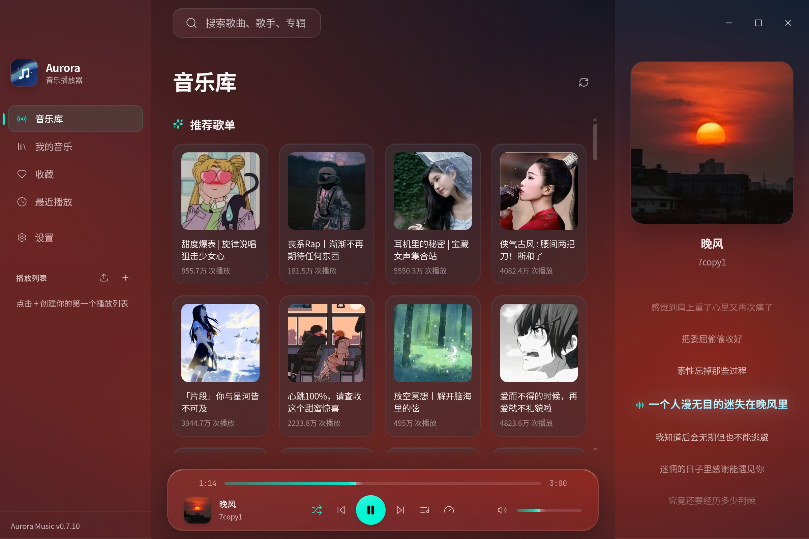
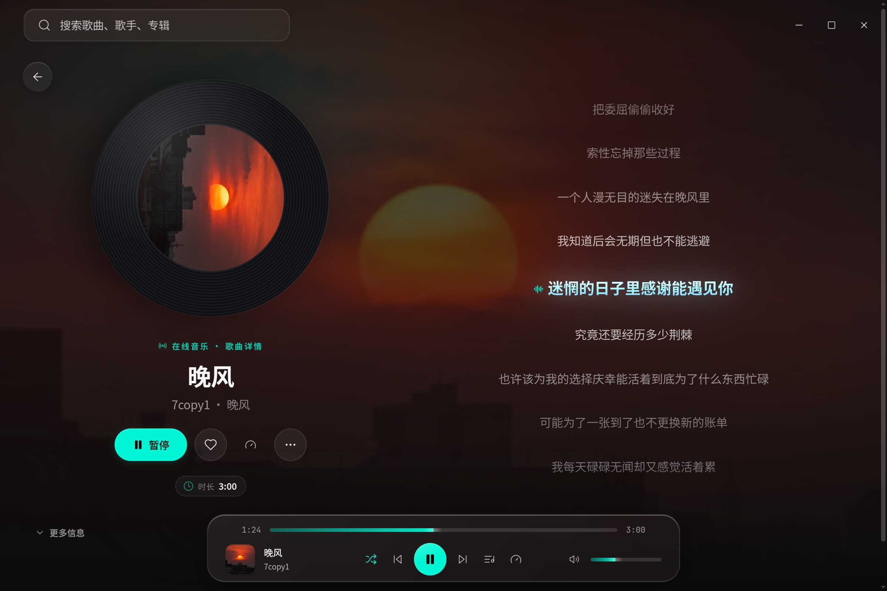
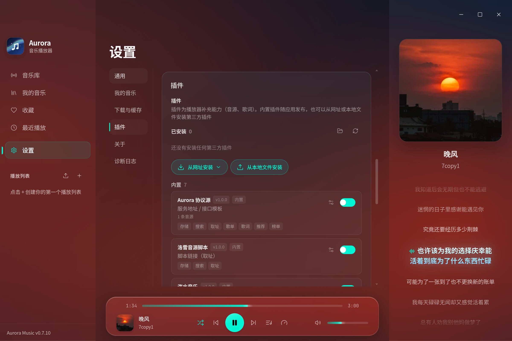

# Aurora Music

<p align="center"></p>

<p align="center">
  <strong>Aurora Music</strong> — 跨平台音乐播放器，桌面（Linux / Windows / macOS）与 Android 同一套界面。<br/>
  桌面端 Electron + React，移动端 Capacitor 打包、原生播放引擎接管播放。<br/>
  
  &nbsp;·&nbsp; <a href="./README.en.md">English</a>
</p>

---

## 截图

<p align="center"></p>

<table align="center"><tr>
  <td></td>
  <td></td>
</tr></table>

<p align="center"></p>

---

## 简介

一个自带曲库管理、在线搜索与多端同步的播放器：本地文件夹和 WebDAV 都能入库，
在线听歌靠你配置的音源，歌单与收藏可以在多台设备间同步。

- **曲库** — 扫描本地文件夹或 WebDAV 媒体库入库，渐进式扫描、离线可播
- **在线** — 搜索 / 试听 / 下载 / 缓存；音源自配，支持协议源与洛雪脚本，只配脚本也能搜（内置「聚合搜索」兜底）
- **歌单与收藏** — 歌单管理、M3U 导入导出；通过 WebDAV 或局域网直连在多设备间同步，局域网支持一键配对
- **播放** — LRC 歌词、队列与循环 / 随机、变速、睡眠定时器；桌面与 Android 都可选择音频焦点行为
- **多端一致** — 桌面托盘播放、Android 前台服务续播；简体中文 / English

---

## 快速开始

```bash
git clone https://github.com/yib0601/aurora-music.git && cd aurora-music
pnpm install
pnpm rebuild          # 重建 better-sqlite3 原生模块
pnpm dev              # 桌面端（Electron + Vite 热重载）
pnpm dev:app          # 仅 Web UI
```

需 Node.js ≥ 20、pnpm ≥ 9.15；Android 构建另需 JDK 17+ 与 Android SDK。

音源协议、歌单同步、插件体系、开发与打包细节见 [docs/](./docs/)。

---

## 许可

[PolyForm Noncommercial License 1.0.0](./LICENSE)：禁止商业用途。个人使用、学习、二次修改与非商业分发不受限制，商业目的的使用需联系作者授权。v0.4.2 及更早的已发布版本仍按 MIT 授权。
